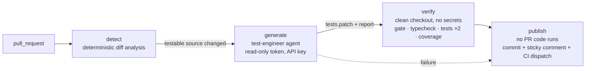

# Solution: test-engineer agent and PR test workflow

A custom **test-engineer** agent with six reusable skills is built on the Claude Agent SDK. It was used to:

1. raise unit-test coverage of the existing app;
2. power a GitHub Actions workflow that, on every pull request, analyses the diff, creates or updates unit tests where appropriate, verifies them independently and reports the results on the PR.



## Where things live

| Part | Path | Role |
| --- | --- | --- |
| Custom agent | [`.claude/agents/test-engineer.md`](.claude/agents/test-engineer.md) | Role, hard rules, procedure, tool allowlist, preloaded skills, write-guard hook |
| Skills | [`.claude/skills/`](.claude/skills) | `analyze-pr-changes`, `coverage-gaps`, `backend-unit-tests`, `frontend-unit-tests`, `run-and-verify-tests`, `report-test-results` |
| Write policy | [`.claude/test-path-policy.mjs`](.claude/test-path-policy.mjs) | One definition of "writable test path", used by all three guard layers |
| Agent runner | [`.github/test-agent/runner/`](.github/test-agent/runner) | Agent SDK host: typed test tools, permission policy, report schema, artifacts |
| Pipeline scripts | [`.github/test-agent/*.mjs`](.github/test-agent) | `detect`, `check-patch` (gate), `verify`, `render-comment` |
| Workflows | [`.github/workflows/test-agent.yml`](.github/workflows/test-agent.yml), [`ci.yml`](.github/workflows/ci.yml) | PR agent workflow; CI for both apps and for the agent tooling |

**How the agent uses them during a run.** The runner starts the SDK `query()` with `agent: 'test-engineer'`. The SDK loads the agent definition and skills with `settingSources: ['project']`; in CI they come from a trusted checkout via `projectConfigRoot`. The skills then come into play in this order:

1. `run-and-verify-tests` and `report-test-results` are preloaded, because every run needs them.
2. The agent loads `analyze-pr-changes` in PR mode, or `coverage-gaps` in coverage mode, and calls the matching tool.
3. It loads the conventions skill for each app it touches before writing tests.
4. It iterates with the `run_tests`, `typecheck` and `coverage` tools.
5. It returns a schema-validated report.

The skill scripts (`analyze-changes.mjs`, `coverage-gaps.mjs`) are plain modules. The runner's tools import them, and you can also run them by hand.

## Main technical decisions

1. **Claude Agent SDK runner instead of the raw CLI, `claude-code-action` or LangGraph.**
   - The SDK gives the full Claude Code agent loop with first-class agents and skills.
   - The runner is our own testable code:
     - a permission callback;
     - in-process tools;
     - a structured-output schema;
     - budget, turn and time caps.
   - LangGraph would have meant rebuilding file tools, guardrails and skill loading, and that is where security bugs would come from.
   - `claude-code-action`'s GitHub App and comment plumbing isn't needed in a job without write access.
2. **No shell for the agent.**
   - Bash is replaced by four typed MCP tools: `analyze_changes`, `run_tests`, `typecheck` and `coverage`.
   - Their arguments are validated with zod. For example, `files` must be existing test files of the given app, so `--config=…` injection is impossible.
   - They run `execFile` without a shell and with a **minimal environment**, so test processes never see `ANTHROPIC_API_KEY` or any token.
3. **Defense in depth on writes**, with one policy module behind three layers:
   1. the SDK `canUseTool` callback;
   2. an SDK `PreToolUse` hook (plus a frontmatter command hook for interactive Claude Code use);
   3. the patch gate.

   The gate rejects:
   - anything outside `backend/tests/**` and `frontend/src/**/*.test.ts(x)`/`src/test/**`;
   - symlinks, mode changes, deletions, renames and binaries;
   - `.only`, `.skip` and `.todo`;
   - credentials, `child_process` and `/proc`/environment access.

   Reads are confined to the checkout and the trusted config, so `/proc/self/environ` is denied.
4. **The PR can't change its own guardrails.** The agent definition, skills, runner and pipeline scripts are always taken from the PR's **base commit** (`projectConfigRoot`); only application code comes from the PR head.
5. **Least privilege per job.**
   - The LLM job has a read-only token.
   - The API key is set only on the agent step.
   - Claude Code's subprocess credential scrubbing and PID isolation are on, using bubblewrap on the runner. A probe fails the job before any API spend if isolation is unavailable.
   - `persist-credentials: false` keeps git credentials out of the workspace.
   - The only job with write access (`publish`) runs no PR code: it does `git apply` of the verified bytes, then gate re-check, commit, push and comment.
   - Untrusted values such as branch names reach shell only through `env`.
   - Actions are pinned by SHA.
   - Fork PRs, drafts and PRs labelled `skip-test-agent` are skipped.
6. **Nothing the agent claims is trusted.**
   - The runner records test results and skill usage from real tool calls.
   - `verify` re-runs everything on a clean checkout of the same SHA: typecheck, the full suites twice (the second time with `--sequence.shuffle`, to catch order-dependent tests), coverage before and after, and prettier.
   - Only a passing patch is committed. If verification fails, publish only comments, and the patch stays available as an artifact.
7. **Correct over green.** The agent may not weaken assertions or touch source. If a correct test fails, it removes the test and reports a **suspected defect** in the PR comment.
8. **Deterministic scoping before LLM judgment.**
   - `detect` classifies files with the same include and exclude rules as each app's coverage config.
   - It maps source to test files and resolves "related tests" (tests that import or mock a changed module).
   - It attaches per-file diffs and decides whether to run at all.
   - PR titles, bodies and comments never enter the prompt, and file paths are validated before they do.
9. **Reliability.**
   - Concurrency is one group per PR.
   - The publisher checks that the PR head is still the SHA that was verified, and pushes without force.
   - The bot commit carries a `Test-Agent: generated` trailer, and a last-processed-SHA marker lives in the sticky comment (only bot-authored comments are trusted). Together they avoid loops and redundant runs.
   - A session self-check aborts before spending budget if a required tool, skill or MCP server is missing. This was added after the first local run exposed exactly that.
10. **Results in the PR.** The PR gets a sticky comment and a job summary. They show:
    - decisions per file;
    - an independent verification table;
    - per-file coverage before and after;
    - suspected defects;
    - skills used, tool calls, turns and cost.

    Agent text is escaped (HTML, mentions, table breakers) before posting.

## Running it

### PR workflow

**Prerequisites:**
- The agent tooling is on the base branch.
- A repository secret `ANTHROPIC_API_KEY`. Use a dedicated key, ideally in its own Console workspace with a spend limit.
- GitHub Actions enabled. The workflow declares its own per-job permissions, so the default read-only token setting is fine.
- If an org policy caps `GITHUB_TOKEN` at read-only, `publish` can't push. It then still comments.
- Optional repository variables:
  - `TEST_AGENT_MODEL`, default `claude-sonnet-5-5`;
  - `TEST_AGENT_MAX_BUDGET_USD`, default 6.

Then open a PR from a branch in the same repository. The workflow runs on `opened`, `synchronize`, `reopened` and `ready_for_review`. Add the label `skip-test-agent` to opt out.

### Locally

These commands need Node 22+, `npm ci` in `backend/`, `frontend/` and `.github/test-agent/runner/`, and `ANTHROPIC_API_KEY` in the shell (never in the repo's `.env`, which backend tests load).

```sh
# Raise coverage (what produced the existing tests)
npm --prefix .github/test-agent/runner run agent -- --mode coverage --apps backend --repo "$PWD" --out "$PWD/.test-agent/backend"

# PR mode on the current branch
node .github/test-agent/detect.mjs --repo . --base "$(git rev-parse main)" --head "$(git rev-parse HEAD)" --out .test-agent/changes.json
npm --prefix .github/test-agent/runner run agent -- --mode pr --repo "$PWD" --changes "$PWD/.test-agent/changes.json" --out "$PWD/.test-agent/pr"

# Tooling tests
npm --prefix .github/test-agent/runner test && node --test '.claude/**/*.test.mjs' '.github/test-agent/*.test.mjs'
```

## Example runs

All runs used `claude-sonnet-5-5` through the SDK runner. Every result was re-verified with `verify.mjs` on a clean git worktree.

### Coverage mode (Part 1)

| App | Agent | Tests | Lines | Branches | Functions |
| --- | --- | --- | --- | --- | --- |
| backend | 25 turns, 47 s, $0.15 | 48 → 80 | 33.0% → 100% | 33.3% → 97.9% | 40.6% → 100% |
| frontend | 61 turns, 144 s, $0.45 | 18 → 78 | 47.7% → 100% | 43.8% → 99.3% | 40.3% → 100% |

- **Skills used:** `coverage-gaps` and the app's conventions skill. The frontend run also preloaded `run-and-verify-tests` and `report-test-results`.
- **The frontend agent caught 7 type errors in its own tests** with `typecheck`, fixed them, and re-ran the shuffled suite.
- **It left one branch uncovered on purpose** and said why: `DeleteTodoDialog`'s `if (pending) return` can't be triggered because the buttons are disabled.
- **I spot-checked the tests:**
  - no weak assertions;
  - the date logic is pinned with fake timers;
  - they pass under `TZ=America/Los_Angeles` and `TZ=Pacific/Kiritimati`.
- **Thresholds were then ratcheted:**
  - backend: per file, 95% lines, functions and statements and 90% branches;
  - frontend: 95% global.
- **The first backend run failed safely.** The SDK `tools` option had dropped `Skill` and `StructuredOutput`. The agent did the work, said it couldn't load skills, and returned prose. The runner rejected the unstructured result, and the session self-check now catches this before any spend.

### PR mode on the demo feature (`feat/task-statistics`)

**The feature:**
- **Backend:** `GET /api/todos/stats?today=` uses Prisma `groupBy` and `count` and must be registered before `/:id`.
- **Frontend:** a `useTodoStatsQuery` hook, a `TodoStatsSummary` card, stats invalidation in the three mutation hooks, and a `toLocalDateString` helper.
- **It ships without tests on purpose.** It also breaks the existing tests: the router fake lacks `stats()`, which is a type error, and 9 `TodosPage` tests fail because a new hook is unmocked.

**The dry run** went detect → agent (trusted config from a `main` worktree) → prettier → patch gate → `verify.mjs` → `render-comment.mjs`:

- **detect:**
  - 15 changed files, 11 testable.
  - Skipped `openapi.json`, both `types.ts` and `queryKeys.ts`, each with a reason.
  - Listed related tests, e.g. `TodosPage.test.tsx` for `useUpdateTodoMutation`.
- **The agent (40 turns, 69 s, $0.26):**
  - **Skills:** `analyze-pr-changes`, `backend-unit-tests` and `frontend-unit-tests`, plus the two preloaded ones.
  - **Decisions:** 11 = 6 `update` and 5 `create`, three of which share `statsInvalidation.test.tsx`.
  - **Updated:** validators, repository (aggregation and query arguments), router (`/stats` ordering, default date, 422 path, fake extended), `todosApi.stats`, `toLocalDateString`, and `TodosPage` (new hook mocked, data flow to the card).
  - **Created:** `TodoStatsSummary` and `useTodoStatsQuery` tests, and stats-invalidation tests for the mutation hooks.
  - **Note:** it flagged that `/stats` defaults to the server's UTC date while the client always sends its local date. That's not a defect, but worth knowing.
- **Gate:** 9 files, 291 added lines, accepted.
- **verify:** both apps passed typecheck, the tests (86/86 backend, 90/90 frontend), the shuffled re-run, and the prettier check (frontend).
- **Coverage:** every changed source file ends at 100% lines and functions.

| Totals | Lines | Branches |
| --- | --- | --- |
| backend | 90.2% → 100% | 83.9% → 98.2% |
| frontend | 85.4% → 100% | 85.6% → 99.3% |

The rendered PR comment from this run is in [`docs/test-agent/example-pr-comment.md`](docs/test-agent/example-pr-comment.md).

## Assumptions

- PR authors are collaborators with write access. Fork PRs are skipped because they get no secrets.
- Unit tests only: no database, network or browser. Generated tests may be committed to the PR branch.
- Testable code is exactly what each app's coverage config measures. The design system is excluded, as the repo already does.
- The test conventions in the skills were derived from the existing tests, which are taken as the house style.

## Limitations

- **The pipeline hasn't yet run on GitHub.** It was validated with actionlint, unit tests for every pipeline script, and a full local dry run. The first real PR run is the remaining step.
- **Test code is arbitrary code.**
  - Test processes get a minimal environment and the gate blocks known exfiltration patterns.
  - But a determined test could still try the network, and `harden-runner` is in **audit** mode, not block.
  - The runner process holding the key isn't isolated from test processes by user or container.
- **Agent changes take effect only after merge**, because config is loaded from the base commit. For the same reason, the PR that first adds the agent can't use it.
- **CI on the bot's commit is dispatched separately.** Pushes with `GITHUB_TOKEN` don't trigger workflows, so `publish` dispatches `ci.yml`, and those checks appear as `workflow_dispatch` runs.
- **Test quality** is enforced by skills, the gate and independent re-runs, not by mutation testing. The agent can still write a weak but passing test.
- **The agent doesn't always follow file-layout conventions exactly.** For example, it grouped the hook tests into one file. Labels such as `create` versus `update` are its own judgment.
- **"Related tests"** only resolves relative imports.
- **Audit advisories:** the apps' pinned `vitest` 4.1.11 and `zod` 4.6.5 have known advisories. The runner uses the patched versions; I didn't change the apps' dependencies.

## For production

- **Pushes:** use a GitHub App token, so pushes trigger CI normally and get a distinct identity, and add CODEOWNERS for `.claude/` and `.github/`.
- **Egress:** switch `harden-runner` to `block`, with the audited allowlist (npm, Anthropic API, GitHub).
- **Isolation:** run test tools in a separate container or user without access to the runner's environment, e.g. gVisor, or a sidecar holding the key.
- **Test strength:** mutation testing (e.g. Stryker) on the changed files to prove the tests can fail.
- **Evals:** a regression suite of golden PRs, with expected decisions and pass rates per model or skill change.
- **Triggers:** an on-demand `/test-agent` comment trigger, and a "suggest-only" mode that posts the patch for review instead of committing.
- **Config:** per-repo configuration (apps, test paths, thresholds, budget), so the agent isn't tied to this monorepo's layout.
- **Ops:** dependency caching, cost and usage dashboards built from `report.json`, and retries with backoff on API errors.
